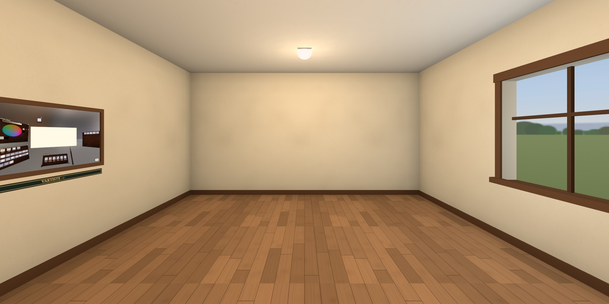

# art

**https://ariamokr.github.io/art/**

A room behind the [Hallway](https://ariamokr.github.io/hallway/)'s door, soon a gallery of art. It is
the room [AriaMoKr/RoomTemplateEmpty](https://github.com/AriaMoKr/RoomTemplateEmpty) makes (a floor,
four walls, a ceiling with its lamps, a window onto the afternoon sky, and the doorway back to the
Hallway) with one thing on its walls so far: across from the window, a framed picture of
[VARTISTE](https://ariamokr.github.io/vartiste/)'s studio, the way into it. The window is in the
right-hand wall, with the sun behind the room, so its light is a painter's north light. Walk it in
VR on a Meta Quest, on a desktop or on a phone. There is nothing to install.



Behind you as you come in is the doorway you came through, glowing rose, with the Hallway seen
through it. Walk back through it (or click or tap it, or point at it in VR and pull the trigger) and
you are back in the Hallway, in front of this room's door. Beside it, on the wall, is the control
panel. On the left-hand wall, across from the window, hangs VARTISTE (below, "On the walls").

## Moving about

As in the Hallway:

| | Look | Walk | Go back out | Wave (in a shared session) |
|---|---|---|---|---|
| Desktop | drag | WASD or arrows (Shift runs), Q/E or ←/→ turn, click the floor | click the doorway, or walk into it | the **Wave** button |
| Phone | drag | tap the floor | tap the doorway | the **Wave** button |
| Headset | your head | left stick walks (or aims a teleport), right stick turns, trigger at the floor teleports | trigger (or pinch) at the doorway, or step through it | squeeze a grip |
| Gamepad | right stick | left stick (click it in to hurry) | aim the dot at the doorway and press A, or walk into it | the **Wave** button |
| TV remote (below, "On a TV") | ←/→ turn | ↑/↓ | the dot on the doorway and OK, or walk into it; or Back | **Wave** in the card (Menu) |

Whatever hangs on the walls (below, "On the walls") is chosen as the doorway is: you walk up to it,
and on through it when it leads somewhere.

The walls stop you. **Fullscreen** and **Enter VR** are at the bottom right (not on a TV). The **control panel**
by the doorway holds Enter or exit VR, how to move and turn in VR (Smooth or Teleport, Snap or
Smooth), the comfort settings below, and Start or Leave shared session. The card at the top left
(the page's navigation) has the same choices as real controls under **Settings**, for a keyboard or
a screen reader, and **← Hallway** as a plain link. The VR choices are the Hallway's own: both read
and keep them in `localStorage` under `hallway.nav` ([AriaMoKr/common](https://github.com/AriaMoKr/common)'s
`nav.js`), so a choice made on either side of the door holds on the other.

### Settings for comfort

Three settings, on the panel and in the card's **Settings**, are shared the same way, under
`hallway.access` (common's `access.js`): set them anywhere on the site and they hold behind every
door.

| Setting | What it does here |
|---|---|
| **Motion**: System, Less or Full | With less motion (System follows the device's own setting) nothing glides: a click on the floor or the doorway is a jump, not a walk; the fades are blinks; the doorway's veil holds still; a waving visitor doesn't bob; and the page's own transitions stop. |
| **Vignette**: On or Off | In VR, while you glide or turn smoothly with the sticks, the edge of the view darkens and closes in, and opens when you stop. Snap turns and teleports blink instead. |
| **Seated**: On or Off | In VR, your view is raised 0.45 m, so sitting down you see the room from about standing height. |

## Coming in through the Hallway's door

The Hallway opens a door's room with the visit added to its address, by the door contract in
[AriaMoKr/common](https://github.com/AriaMoKr/common)'s README ("Going in", "Linking back"), whose
`door.js` the room reads it with. It reads it once and takes it off the address, so a reload, Back
or a shared link doesn't arrive again; `room` stays.

| Parameter | What the room does with it |
|---|---|
| `from=hallway`, `back`, `backname` | The doorway leads back to `back`, called the Hallway when it is the Hallway's own page (or, developing, when both are on this machine); any other address is named by its host, or by `backname`. Without `back`, it leads to the Hallway anyway, at `?from=art`, in front of this room's door. The way back lasts the tab (`sessionStorage`). |
| `dx`, `yaw`, `pitch` | You come in where you went through (`dx` across the doorway), turned and looking as you were. |
| `dw`, `dh`, `glow` | The doorway is that wide and high, and glows in that colour. |
| `room` | You stay in the shared session (below); the doorway back carries it on. |

Walking in from the Hallway's VR, Quest Browser can hand this page the immersive session without a
click (`sessiongranted`): the room listens for it from the first script on the page and takes it at
once, so you stay in VR, as long as both are on `ariamokr.github.io`.

Through the doorway you see the Hallway: the view it publishes out of its door to here
(`views/views.json` beside the Hallway, under `art`; common's README, "The view from your door").
Until the Hallway has a door to here and has published that view, and whenever the way back is not
the Hallway, the doorway shows its glow and the name of where it leads.

## The Hallway's door

The Hallway has a door to here. Its entry in the Hallway's
[`public/js/environments.js`](https://github.com/AriaMoKr/hallway/blob/main/public/js/environments.js)
is the config's `hallwayDoor()`:

```js
{
  id: 'art',
  title: 'art',
  subtitle: "A room behind the Hallway's door, soon a gallery of art, with the way into VARTISTE's painting studio on its wall.",
  sign: 'Art Room',
  url: 'https://ariamokr.github.io/art/',
  preview: 'https://ariamokr.github.io/art/hallway-preview.jpg',
  color: '#e08fb0',
},
```

As the Hallway's README asks ("Adding a door"), the title on the plaque by the door is the
repository's name and the subtitle is the page's description word for word, so when the
description changes, the Hallway's entry changes with it. Once the Hallway has rendered its `views/`
with the door, the doorway back here shows the hall.

## Together

The Hallway's shared session ([AriaMoKr/layersharedsession](https://github.com/AriaMoKr/layersharedsession),
peer to peer over WebRTC) comes in here too. Come in from the Hallway in a session and you join the
same room here, as `art`; the others in here are drawn by the layer's avatars. **Start shared
session**, on the panel or in the card, starts one here; **Copy invite link** copies
its address (on a TV the card shows it, to open on a phone or a computer), **Wave** (or a grip in
VR) waves to everyone in it, and the card has your name in it, to change. The doorway back carries
the session into the Hallway.

## On the walls

What hangs on the walls is in the config, `pieces`. So far there is one: on the left-hand wall,
across from the window, a framed picture of VARTISTE's studio, labelled **VARTISTE →**. It is the way
into [VARTISTE](https://ariamokr.github.io/vartiste/), Zach Capalbo's painting app for VR and the
screen, as AriaMoKr's fork ([AriaMoKr/vartiste](https://github.com/AriaMoKr/vartiste)) publishes it.
Choose it (click or tap it, point at it in VR and pull the trigger, or put the dot on it and press A
or OK) and you walk up to it, the room fades, and VARTISTE opens; in VR, or with less motion, at
once. The card lists it under **On the walls**, as a link.

VARTISTE gets the way back on its address (common's `hallLink`: `back`, this room at `?from=studio`,
and `backname=art`). Its **← art**, on the page and as Back to art in VR, brings you back to stand
in front of the picture, facing into the room, with the doorway still leading where it did. In VR on
a Quest, the browser hands VARTISTE the immersive session as it hands the Hallway's rooms theirs,
since both are on `ariamokr.github.io`.

Each piece is a framed picture with its title on a label under it, and may lead somewhere; the
template's README ("On the walls") has the fields. The pictures are in `public/gallery/`:
`vartiste.jpg` is VARTISTE's studio as it opens, 1280 × 720, taken in headless Chrome through
common's `tools/chrome.mjs`. `npm test` checks that each piece fits on its wall, clear of the window
and the others. The frames and the labels cost nothing more per piece, but each picture is a draw
call and a texture of its own, against the TV's budget ("On a TV").

## On a TV

In the Hallway's Android TV app ([AriaMoKr/HallwayApp](https://github.com/AriaMoKr/HallwayApp): the
site full screen in a WebView whose user agent ends ` HallwayTV/<version>`), or in any browser with
`?tv=emulate`, the room is walked with the TV's remote, as common's README has it ("The TV app"),
through its `tv.js`, as in the template:

- The arrows walk and turn. OK uses what the dot in the middle of the view is on: the doorway, a
  button on the panel, or the floor (it walks there).
- **Menu** (or holding Back) moves the focus into the card, starting at **← Hallway**. There, up
  and down go from control to control, left and right go through a choice, and OK chooses. The card
  holds Start or Leave shared session; in a session, Wave, your name, and the invite link as text
  (there is nothing to copy it to); and Settings, with every button on the panel. **Back** walks
  again.
- Stepping onto your name keeps the TV's keyboard down, so the arrows go on past it. OK brings the
  keyboard up to type, and Enter keeps the name.
- Back while walking goes back a page, to the room's door in the Hallway.
- There is no Fullscreen or Enter VR. The card and the hint are the 10-foot view (`html.tv` in
  `style.css`): the page is 960 × 540 at a pixel ratio of 2, with larger text, focus rings that show
  from across the room, and the TV's safe margins.
- The hint is also the view's description, which TalkBack reads. Once it has faded, it leaves the
  reading order, so TalkBack doesn't stop on an empty spot.

When the art comes in, the gallery keeps the remote working if:

- **What it adds in 3D works with OK.** Anything a click or a tap uses (a picture, a label, a
  light), OK uses too, when `controls.js`'s `_use` handles it. Anything used only with a letter key,
  the mouse or a control in 3D is also a real control in the card, where the remote reaches it.
- **It reads keys through `keyOf(e)`** (common's `tv.js`). The remote's OK, and keys sent with
  `adb shell input keyevent`, come with no `code`.
- **Back undoes its own step first.** If the room has something to step back from (a picture taken
  up to look at close, its text opened), Back undoes it: that goes in `main.js`'s `stepBack`, which
  returns true when it took a step. Otherwise the app goes back a page.
- **A text box needs nothing of its own.** Common's remote keeps the TV's keyboard down while it
  steps onto a box and past it, and brings it up on OK. Don't give a box `inputmode="none"`.
- **Nothing needs a keyboard, a pointer or a headset alone**, and there are no local-file controls.
- **It stays within the frame budget.** On the TV the template was measured on (a Sony BRAVIA 4K
  VH21: Android 12, a Mali-G52, WebView 155), its empty room holds 60 fps at 1080p at a pixel ratio
  of 2: 241 frames, none dropped, the 95th percentile at 16.8 ms. On that TV art, then still empty,
  held 59.9 fps, and the remote and TalkBack reached everything in it (HallwayApp's README, "Behind
  the doors"). That full frame is the budget the pictures and their lights can spend; the studio's
  picture is one draw call and a 1280 × 720 texture of it. Check it with HallwayApp's
  `tools/tv-check.mjs --url https://ariamokr.github.io/art/` (a debug build), and keep it at 60.

## Running it

You need Node.js 22 or newer.

```bash
npm install       # three.js, common, the shared-session layer, Trystero and IWER, copied into public/vendor/ by common's tools/vendor.mjs from vendor.json
npm start         # http://localhost:8096/
npm test          # node --test: the config, where you may walk, the way back's address, the vendor list, the page, and tsc's check of public/js/
npm run types     # tsc's check alone
npm run preview   # public/hallway-preview.jpg and public/social.jpg, in headless Chrome
```

`public/` is the whole site: any static server can serve it once `npm install` has filled
`public/vendor/`. `?xr=emulate` installs Meta's IWER emulator (a virtual Quest 3), and `?tv=emulate`
shows the TV's page (Escape stands in for Back in the card, and `hallwayTV.menu()` in the console
for Menu). For a Quest or the TV over adb, `adb reverse tcp:8096 tcp:8096` and start the server on
IPv4 (`npm start -- --host 127.0.0.1`).

`npm test` type-checks `public/js/` with TypeScript, from the modules' JSDoc (`tsconfig.json`:
`allowJs`, `checkJs`, `noEmit`), against three.js's types and common's and the shared session's.
Nothing is built: the page is served as it is, and the import map stays. What TypeScript's DOM
library leaves out is in `types/globals.d.ts`. The check isn't `strict` yet; that comes a file at a
time, and `tools/` and `test/` come later.

To try the way in and out locally, serve the Hallway's checkout as well (on 8088) and open the room
as its door would:

```
http://localhost:8096/?from=hallway&back=http%3A%2F%2Flocalhost%3A8088%2F%3Ffrom%3Dart&dx=0.2&yaw=-15&pitch=-5&dw=1.1&dh=2.25&glow=e08fb0
```

## The pictures

`npm run preview` (`tools/preview.mjs`) renders two pictures in headless Chrome, and they are
committed:

- `public/hallway-preview.jpg`, 2048 × 1024: the room from where one arrives, at eye height, facing
  in, hung as the Hallway hangs its doorways' pictures. The Hallway's doorway to here shows it.
- `public/social.jpg`, 1280 × 640: the room from across it, looking back at the doorway and the
  window. The page's `og:image` and `twitter:image` show it, and it is the repository's social
  preview.

Render them again whenever the room changes. Chrome starts through common's `tools/chrome.mjs`, on a
new profile that is first told the Windows password is not blank, so it never tries a logon to find
out. Never start Chrome for these by hand on a new profile.

## Made from the template

This repository began as a copy of [RoomTemplateEmpty](https://github.com/AriaMoKr/RoomTemplateEmpty),
by its README's "Making a room from this template". What makes it this room rather than the template
is [`public/js/config.js`](public/js/config.js) (the id `art`, its title, description, sign and
address, the window in the right wall and the sky's yaw, the port 8096, the rose glow), with
`package.json`, `index.html`, `.claude/launch.json`, the pictures and these notes to match;
`npm test` checks the page and the package say what the config says. What hangs on the walls is in
the config too (`pieces`), with its pictures in `public/gallery/`; the rest of `public/js/` is still
the template's, ready to become the gallery.

The template's fixes come here by merging it, as the TV's remote did: art's history starts at the
template's first commit, so with the template as a remote named `template`
(`git remote add template https://github.com/AriaMoKr/RoomTemplateEmpty.git`, once):

```bash
git fetch template
git merge template/main
```

In a merge, art keeps its own `config.js` values, `index.html`, `package.json`'s name and
description, the two pictures, the port 8096 and `main.js`'s opening comment, and its README says
what the template's says in art's words. If `package.json` or `package-lock.json` conflict, art
keeps its name and description and takes the template's dependencies, and `npm install` makes the
lockfile again.

## Publishing

`.github/workflows/pages.yml` publishes `public/` to GitHub Pages on every push to `main`, after
the tests (tsc's check among them), through the sites' workflow in
[AriaMoKr/common](https://github.com/AriaMoKr/common) (`v0.6.3`, on Node 24). Every URL in the page is relative, so it works under any repository's path.

## License

[MIT](LICENSE).
